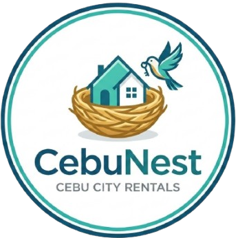

<div align="center">
  

  <h1>CebuNest</h1>

  <p>
    <strong>Multi-Platform Rental Property &amp; Lease Management System</strong>
  </p>

  <p>
    
    
    
    
    
    
  </p>

  <p>
    <a href="https://cebunest.vercel.app">Live Demo</a> &middot;
    <a href="#overview">Overview</a> &middot;
    <a href="#core-capabilities">Capabilities</a> &middot;
    <a href="#architecture-and-tech-stack">Architecture</a> &middot;
    <a href="#project-structure">Structure</a> &middot;
    <a href="#api-modules">API Modules</a> &middot;
    <a href="#getting-started">Getting Started</a>
  </p>
</div>

---

## Overview

**CebuNest** is a multi-platform property rental and lease management ecosystem engineered to centralize the end-to-end rental lifecycle for **Tenants**, **Property Owners**, and **Platform Administrators**.

Backed by a modular **Spring Boot** REST API, the platform powers both a **React + TypeScript** web application and a native **Kotlin Android** mobile companion. From verified property discovery and rental applications to **PayMongo** online rent settlement, automated lease tracking, owner revenue analytics, and administrative audit logging, CebuNest consolidates property operations into a single, secure architecture.

---

## Core Capabilities

### Tenant Experience (Web & Android)

* **Property Discovery:** Browse available listings with property classifications, multi-image galleries, and detailed specifications.
* **Rental Applications:** Submit, monitor, and manage rental requests directly from web or mobile clients.
* **Lease Management:** Inspect active leases, track lease durations, and submit lease extension requests.
* **Online Rent Settlement:** Process monthly rental payments via **PayMongo** integration and review itemized payment history.
* **Reviews & Ratings:** Publish verified reviews and evaluate feedback on listed properties.
* **Notifications:** Receive real-time updates on application decisions, payment confirmations, and administrative broadcasts.

### Property Owner Portal (Web)

* **Listing Management:** Create and maintain rental properties with cloud-backed image uploads via **Supabase Storage**.
* **Property Edit Requests:** Submit listing modifications through a structured review workflow for administrative approval.
* **Application & Lease Oversight:** Approve or decline tenant applications, monitor active leases, and process lease extension requests.
* **Owner Analytics:** Track occupancy trends, rental revenue performance, and property metrics.
* **Billing Visibility:** Monitor tenant billing schedules and payment completion statuses.

### Admin Control Panel (Web)

* **User Administration:** Manage platform accounts, roles, and access permissions.
* **Property Moderation:** Review, edit, override, or deactivate property listings across the platform.
* **Edit Request Review:** Inspect property edit submissions side-by-side and approve or reject proposed changes.
* **Rental Oversight:** Monitor platform-wide rental requests and operational status.
* **System Broadcasts:** Dispatch platform-wide announcements to targeted or all user groups.
* **Audit Logging:** Maintain an immutable trail of administrative actions for accountability and compliance.

### Security & Platform Infrastructure

* **Stateless Authentication:** JWT-based session handling (`JwtUtil`, `JwtAuthFilter`) paired with Spring Security and role-based access control.
* **Google OAuth Integration:** Streamlined authentication and onboarding via Google accounts.
* **Password Recovery Workflow:** Email-delivered OTP verification and secure credential reset via SMTP (`EmailService`).
* **Scheduled Automation:** Background lease-tracking and maintenance routines managed by `SchedulerService` and `LeaseTrackerService`.
* **Health Monitoring:** Dedicated `/health` endpoint for container orchestration and uptime checks.

---

## Architecture and Tech Stack

| Layer | Technology | Responsibility |
| :--- | :--- | :--- |
| **Backend API** | Java, Spring Boot, Maven | Feature-sliced REST API covering Auth, Properties, Rentals, Payments, Analytics, and Admin |
| **Security** | Spring Security, JWT, Google OAuth | Stateless token validation, OAuth verification, and role-based route authorization |
| **Web Frontend** | React, TypeScript, Vite, Axios, CSS Modules | Modular SPA with role-based layouts, `ProtectedRoute` guards, and scoped styling |
| **Mobile Client** | Android (Kotlin), Retrofit, XML, Navigation Component | Native mobile client for tenant authentication, browsing, rentals, and notifications |
| **Payments** | PayMongo API | Online rental payment processing and billing reconciliation |
| **Cloud & Messaging** | Supabase Storage, JavaMail (SMTP) | Media asset persistence and transactional OTP/recovery emails |
| **Containerization** | Docker | Reproducible backend deployment via `backend/cebunest/Dockerfile` |
| **Testing** | JUnit, Mockito | Unit test suites covering core backend services and business rules |

---

## Project Structure

```text
IT342-Saligue-CebuNest/
├── backend/
│   └── cebunest/                             # Spring Boot REST API
│       ├── src/main/java/edu/cit/saligue/cebunest/
│       │   ├── analytics/                    # Owner analytics controller & service
│       │   ├── auth/                         # Login, Register, Google OAuth, Password Reset, JWT
│       │   ├── health/                       # Service health check endpoint
│       │   ├── infrastructure/               # DataInitializer, EmailService, SupabaseStorageService
│       │   ├── notifications/                # User notifications & Admin broadcasts
│       │   ├── payments/                     # Rental billing & PayMongo gateway integration
│       │   ├── properties/                   # Catalog, Management, Edit Requests, Admin & Audit Logs
│       │   ├── rentals/                      # Tenant applications, Lease tracking & Extensions
│       │   ├── reviews/                      # Property reviews & ratings
│       │   ├── scheduler/                    # Automated scheduled tasks
│       │   └── users/                        # User profiles & Admin user management
│       ├── src/test/                         # Service-layer unit test suite
│       ├── Dockerfile                        # Backend container definition
│       └── pom.xml                           # Maven project configuration
│
├── web/                                      # React + TypeScript + Vite Web Application
│   ├── public/                               # Static assets & branding (cebunest-logo.png)
│   └── src/
│       ├── api/                              # Axios instance & shared API utilities
│       ├── components/                       # Navbar, OwnerNavbar, AdminSidebar, ProtectedRoute
│       └── modules/                          # Feature modules (Auth, Admin, Owner, Tenant)
│
├── mobile/                                   # Native Android Application (Kotlin)
│   └── app/src/main/
│       ├── java/com/cebunest/app/
│       │   ├── core/                         # RetrofitClient, ApiError, SessionManager
│       │   └── modules/                      # Auth & Tenant modules (Home, Rentals, Profile, Notifications)
│       └── res/                              # XML layouts, drawables, navigation graph
│
└── docs/                                     # Software Design Documentation
    ├── SDD_CebuNest_Saligue.pdf
    └── SDD_CebuNest_Saligue.docx
```

---

## API Modules

The backend exposes RESTful endpoints organized by business domain:

| Domain Package | Controllers | Responsibility |
| :--- | :--- | :--- |
| `auth` | `LoginController`, `RegisterController`, `GoogleAuthController`, `ForgotPasswordController`, `MeController` | Credential auth, Google OAuth, JWT validation, and OTP password recovery |
| `properties` | `CatalogController`, `PropertyManagementController`, `PropertyEditRequestController`, `AdminPropertyController` | Public catalog, owner listing CRUD, edit request workflows, admin overrides, and audit logs |
| `rentals` | `TenantRentalController`, `OwnerRentalController`, `LeaseExtensionController` | Rental applications, lease lifecycle management, and extension approvals |
| `payments` | `RentalPaymentController` | Billing generation, payment history, and PayMongo checkout integration |
| `analytics` | `OwnerAnalyticsController` | Owner revenue, occupancy, and portfolio performance metrics |
| `reviews` | `PropertyReviewController` | Tenant property ratings and review management |
| `notifications` | `NotificationController`, `AdminNotificationController` | User notifications and administrative system broadcasts |
| `users` | `ProfileController`, `AdminUserController` | Profile administration and admin user/role management |
| `health` | `HealthController` | Service liveness and deployment health verification |

---

## Getting Started

### Prerequisites

Ensure the following tools and services are available in your environment:

* **Java 17+** (or use the included Maven Wrapper `./mvnw`)
* **Node.js 18+** and **npm**
* **Android Studio** (for building and running the Kotlin mobile application)
* **Relational Database** (configured in `backend/cebunest/src/main/resources/application.properties`)
* **External Service Credentials:** Supabase Storage, PayMongo API, Google OAuth Client ID, and SMTP Mail
* **Docker** *(optional, for containerized backend deployment)*

### 1. Backend Setup

1. Navigate to the backend directory:

   ```bash
   cd backend/cebunest
   ```

2. Configure your database connection, JWT secret, Supabase keys, PayMongo keys, Google OAuth Client ID, and SMTP settings in `src/main/resources/application.properties` (or via environment variables).

3. Build and run the service using the Maven wrapper:

   ```bash
   ./mvnw spring-boot:run
   ```

   *On Windows:*

   ```cmd
   mvnw.cmd spring-boot:run
   ```

#### Running the Backend with Docker

```bash
cd backend/cebunest
docker build -t cebunest-backend .
docker run -p 8080:8080 --env-file .env cebunest-backend
```

### 2. Web Application Setup

1. Navigate to the web directory:

   ```bash
   cd web
   ```

2. Install dependencies:

   ```bash
   npm install
   ```

3. Configure environment variables in `web/.env`:

   ```env
   VITE_API_BASE_URL=http://localhost:8080/api
   VITE_GOOGLE_CLIENT_ID=your_google_client_id
   ```

4. Start the development server:

   ```bash
   npm run dev
   ```

5. Build for production:

   ```bash
   npm run build
   ```

### 3. Mobile Application Setup

1. Open **Android Studio** and import the `mobile/` directory.
2. Allow Gradle to sync all project dependencies.
3. Update the API base URL in `RetrofitClient.kt` to point to your backend instance (e.g., `http://10.0.2.2:8080/` for the Android Emulator or your local network IP for physical devices).
4. Build and deploy the application to an emulator or Android device.

---

## Testing

Execute the backend unit test suite covering Analytics, Authentication, Payments, Properties, Rentals, Reviews, and User services:

```bash
cd backend/cebunest
./mvnw test
```

---

## Documentation

Complete architectural diagrams, entity-relationship schemas, and system design specifications are available in the `docs/` directory:

* [`SDD_CebuNest_Saligue.pdf`](docs/SDD_CebuNest_Saligue.pdf)

---

## Author

**Saligue**  
*IT342 — Cebu Institute of Technology - University*
